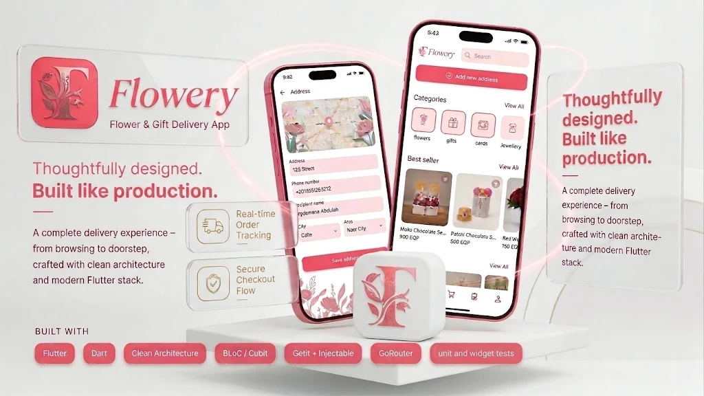

# 🌸 Flower App – Flowers & Gifts E-Commerce

<p align="center">
  
</p>

<p align="center">
  <strong>A Modern, Feature-Rich Flowers & Gifts E-Commerce Mobile Application Built with Flutter.</strong>
</p>

<p align="center">
  
  
  
  
  
</p>

Flower App is a cross-platform Flutter e-commerce application designed to provide a seamless shopping experience for flowers and gifts. Built using Feature-First Clean Architecture, it offers a complete shopping workflow, including authentication, product discovery, cart management, orders, profile management, and bilingual support (English & Arabic).

---

## 📸 Screenshots

<p align="center">
  
  
  
  
</p>

<p align="center">
  
  
  
  
</p>

<p align="center">
  
  
</p>

---

## 📑 Table of Contents

- [Overview](#-overview)
- [Features](#-features)
- [Tech Stack](#-tech-stack)
- [Architecture](#-architecture)
- [Project Structure](#-project-structure)
- [Getting Started](#-getting-started)
- [Code Generation](#-code-generation)
- [Localization](#-localization)
- [Testing](#-testing)
- [API Integration](#-api-integration)
- [Development Notes](#-development-notes)

---

## 🎯 Overview

Flower App is a feature-rich Flutter e-commerce application that delivers a complete shopping experience for flowers and gifts.

The application supports both guest and authenticated users, allowing customers to explore products, discover collections, manage shopping carts, place orders, and personalize their profiles.

It integrates with the Elevate Flower REST API and follows modern software engineering principles to maintain clean, scalable, and testable code.

## ✨ Features

### 🔐 Authentication & Account Management
- User registration and login.
- Guest browsing experience.
- Logout functionality.
- Forgot password and change password flows.
- Secure authentication token storage.

### 🛍️ Product Discovery & Shopping
- Browse products by categories and occasions.
- Explore best-selling products.
- View detailed product information.
- Search and sort products.
- Reusable product cards and shared product components.

### 🛒 Cart Management
- Add products to the shopping cart.
- Remove items and update quantities.
- Calculate cart totals.
- Review shopping cart contents.

### 📦 Orders
- Fetch and display customer orders.
- View order information and details.

### 👤 Profile Management
- View and update profile information.
- Upload profile pictures.
- Manage application language preferences.
- Handle guest and authenticated user states.

### 🌍 Localization
- Full English and Arabic language support.
- Flutter localization using ARB files.
- Dynamic language selection.

### 🔒 Secure Storage & Networking
- Secure token persistence using `flutter_secure_storage`.
- Centralized networking configuration using Dio.
- Type-safe REST API integration with Retrofit.
- JSON serialization and deserialization.

### 🧪 Testing
- Unit tests for data sources and repositories.
- Use case testing.
- Cubit testing.
- Mocked dependencies using Mocktail and Mockito.

---

## 🛠️ Tech Stack

| Category | Technologies |
|---|---|
| Framework | Flutter & Dart |
| Architecture | Feature-First Clean Architecture |
| State Management | Flutter BLoC / Cubit |
| Navigation | GoRouter |
| Networking | Dio & Retrofit |
| Serialization | JSON Serializable |
| Dependency Injection | GetIt & Injectable |
| Secure Storage | Flutter Secure Storage |
| Localization | Flutter Localizations & ARB |
| Testing | Flutter Test, Bloc Test, Mocktail, Mockito |
| Code Generation | Build Runner |

---

## 🏗️ Architecture

The project follows a **Feature-First Clean Architecture** approach, separating presentation logic, business rules, and data operations into independent layers.

Each feature is organized into the following layers:

| Layer | Responsibility |
|---|---|
| Presentation | Screens, reusable widgets, Cubits, intents, and states |
| Domain | Business entities, repository contracts, and use cases |
| Data | DTOs, repository implementations, and data source contracts |
| API | Retrofit clients and remote data source implementations |

### Architecture Benefits

- **Separation of Concerns:** Each layer has a clearly defined responsibility.
- **Maintainability:** Features are organized independently.
- **Testability:** Business logic can be tested without depending on UI or external services.
- **Scalability:** New features can be added without tightly coupling existing modules.
- **Reusability:** Shared components and business logic can be reused across features.

---

## 📂 Project Structure

```text
lib/
├── config/
│   ├── di/                     # Dependency injection setup
│   ├── dio/                    # Dio configuration
│   └── security_storage/       # Secure storage abstraction
│
├── core/
│   ├── errors/                 # Exceptions and failures
│   ├── localization/           # Locale management
│   ├── network/                # API interceptors
│   ├── router/                 # GoRouter configuration
│   ├── shared_features/        # Shared products and home data
│   ├── theme/                  # Colors, typography, and themes
│   ├── values/                 # Constants, assets, and fonts
│   └── widgets/                # Shared UI components
│
├── features/
│   ├── app_sections/           # Main app shell, home, cart, categories, profile
│   ├── auth/                   # Login, sign up, and forgot password
│   ├── best_seller/            # Best-selling products
│   ├── change_password/        # Change password
│   ├── edite_profile/          # Edit profile
│   ├── occasion/               # Occasion listing
│   ├── orders/                 # Customer orders
│   ├── product_details/        # Product details
│   └── search/                 # Product search
│
├── l10n/                       # Localization ARB files and generated classes
│
└── main.dart                   # Application entry point

assets/
├── icons/                      # SVG icons
└── fonts/                      # Inter font family

test/                           # Unit and Cubit tests
```

---

## 🚀 Getting Started

Follow these steps to set up and run the application locally.

### Prerequisites

- Flutter SDK compatible with Dart `^3.11.0`.
- Android Studio or Visual Studio Code.
- Xcode for iOS development (macOS only).
- Configured Android emulator, iOS simulator, or physical device.

Verify your Flutter installation:

```bash
flutter doctor
```

### Installation

**1. Clone the repository**

```bash
git clone https://github.com/mohamedaly0206/Flower-App.git
```

**2. Navigate to the project directory**

```bash
cd Flower-App
```

**3. Install dependencies**

```bash
flutter pub get
```

**4. Generate required files**

```bash
dart run build_runner build --delete-conflicting-outputs
```

**5. Run the application**

```bash
flutter run
```

### Running on Specific Platforms

```bash
flutter run -d android
flutter run -d chrome
flutter run -d ios
flutter run -d windows
```

---

## ⚙️ Code Generation

The project uses code generation for:

- Retrofit API clients.
- JSON serialization and deserialization.
- Dependency injection.
- Generated assets and fonts.

After modifying annotated API clients, models, or dependency injection classes, run:

```bash
dart run build_runner build --delete-conflicting-outputs
```

For continuous code generation during development:

```bash
dart run build_runner watch --delete-conflicting-outputs
```

---

## 🌍 Localization

The application supports both English and Arabic using Flutter's localization system.

### Configuration

- Localization configuration: `l10n.yaml`
- English translations: `lib/l10n/app_en.arb`
- Arabic translations: `lib/l10n/app_ar.arb`
- Generated localization classes: `lib/l10n/app_localizations.dart`

### Supported Locales

- 🇬🇧 English (`en`)
- 🇪🇬 Arabic (`ar`)

After modifying translation files, regenerate localization classes:

```bash
flutter gen-l10n
```

---

## 🧪 Testing

The project includes unit and Cubit tests to help ensure application reliability and maintainability.

### Run All Tests

```bash
flutter test
```

### Run Static Analysis

```bash
flutter analyze
```

### Testing Coverage Areas

- Remote data sources.
- Repository implementations.
- Business use cases.
- Cubits and presentation state management.

---

## 🌐 API Integration

The application integrates with the **Elevate Flower REST API**.

**Base URL:**

```text
https://flower.elevateegy.com/api/v1
```

### Main API Modules

- Authentication and user profile.
- Products and product details.
- Categories.
- Occasions.
- Shopping cart.
- Orders.
- Best sellers.

API endpoint definitions are organized in:

```text
lib/core/values/api_endpoints.dart
```

The networking layer uses Dio and Retrofit to provide structured, maintainable, and type-safe API communication.

---

## 📝 Development Notes

- Follow the existing Feature-First Clean Architecture when adding new features.
- Keep business logic inside the domain and presentation logic layers rather than directly inside UI widgets.
- Use Cubits to manage feature-specific state.
- Keep API communication centralized through Retrofit and Dio.
- Regenerate generated files whenever annotated source files change.
- Update localization ARB files when introducing new user-facing strings.
- Add relevant tests when modifying repositories, use cases, or Cubits.

---

<p align="center">
  <strong>Built with 💗 using Flutter</strong>
</p>
